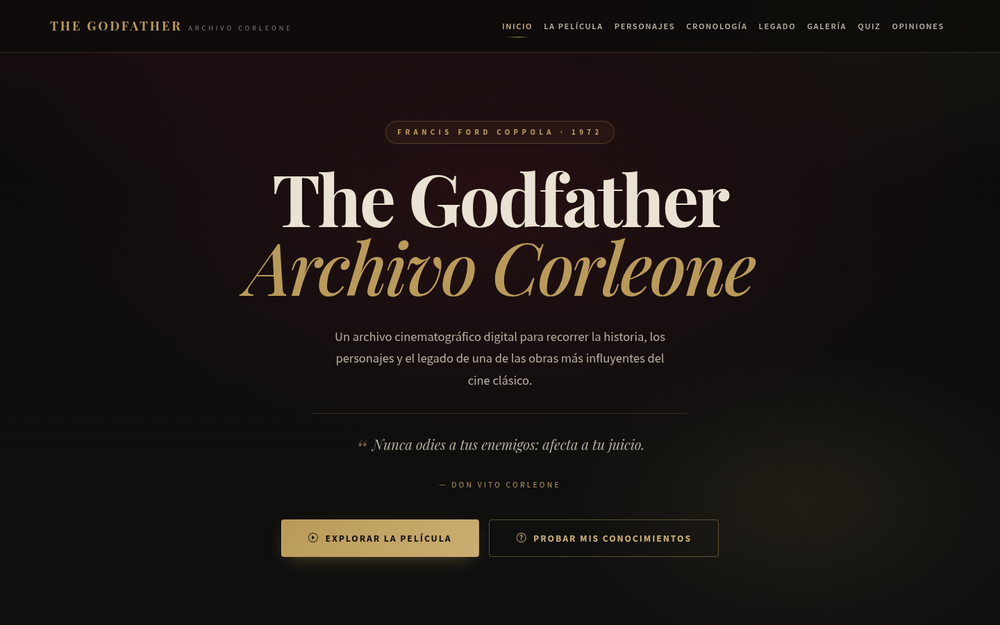
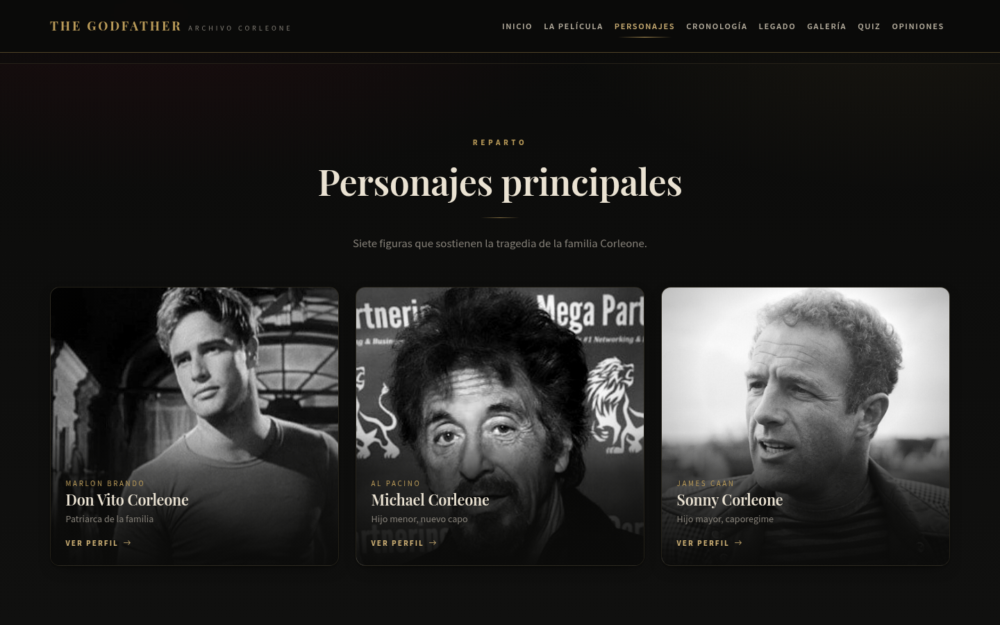
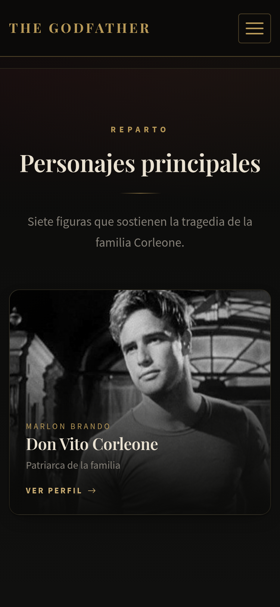
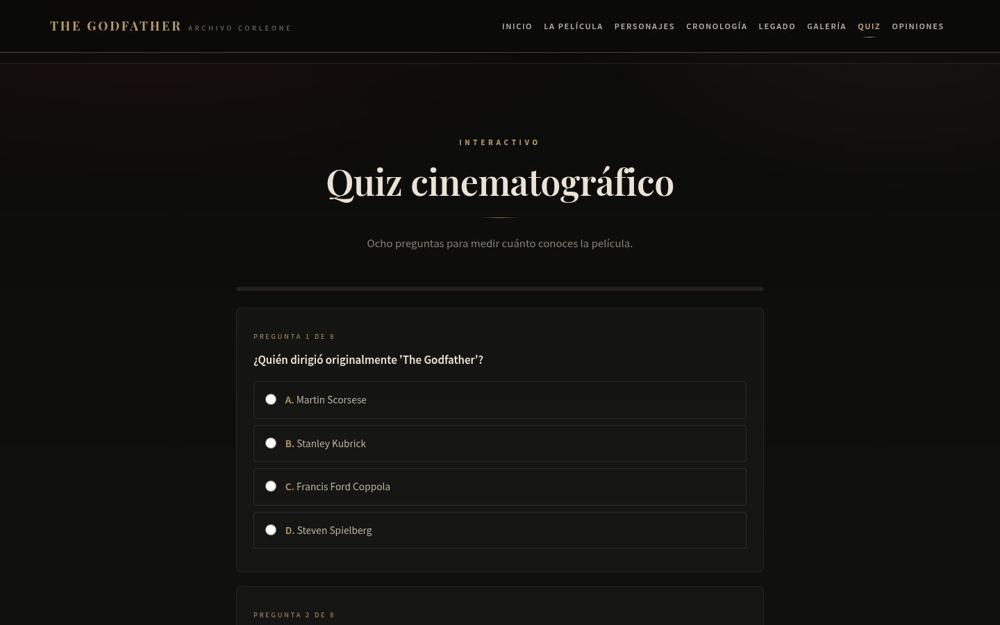
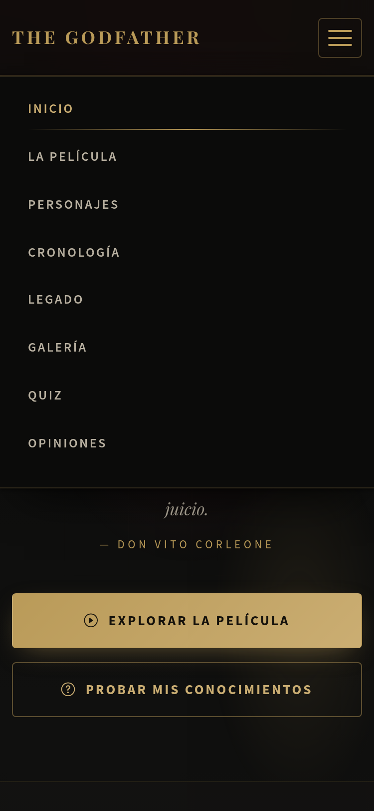
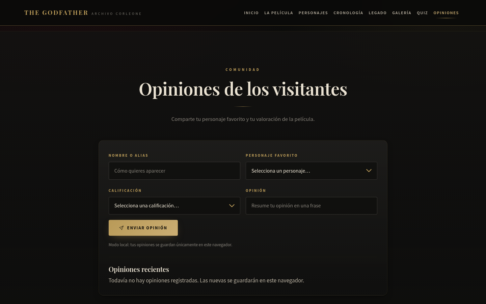
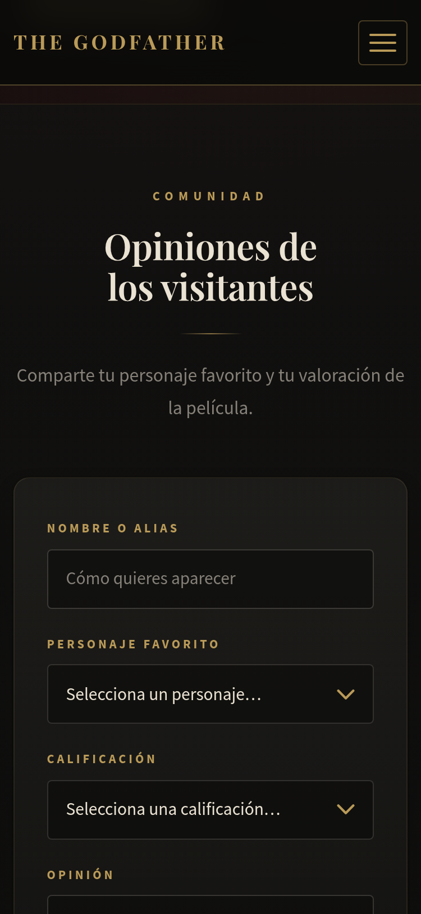

# The Godfather — Archivo Corleone

Archivo cinematográfico digital interactivo sobre *The Godfather* (1972), construido con
**Bootstrap 5.3**, JavaScript moderno y Vite. Proyecto académico de la **Evidencia 21:
Desarrollo de aplicativo Bootstrap** del SENA.



## Contenido

- [Objetivo académico](#objetivo-académico)
- [Demostración de Bootstrap 5.3](#demostración-de-bootstrap-53)
- [Secciones de la aplicación](#secciones-de-la-aplicación)
- [Tecnologías](#tecnologías)
- [Instalación y ejecución](#instalación-y-ejecución)
- [Configuración de Supabase](#configuración-de-supabase)
- [Accesibilidad y rendimiento](#accesibilidad-y-rendimiento)
- [Verificación](#verificación)
- [Estructura del proyecto](#estructura-del-proyecto)
- [Despliegue](#despliegue)
- [Capturas de pantalla](#capturas-de-pantalla)
- [Créditos y uso del contenido](#créditos-y-uso-del-contenido)

## Objetivo académico

Demostrar el dominio de Bootstrap 5.3 en una aplicación real, responsiva y accesible:

| Requisito | Cómo se cumple |
|---|---|
| Rejilla de Bootstrap | `container`, `row`, `col-lg-*`, `col-md-*`, `g-*` en todas las secciones |
| Navbar responsive | `navbar navbar-expand-lg fixed-top` + `collapse` con toggler |
| Tarjetas | `card`, `card-body`, `card-title`, `card-img-top` en personajes y fichas |
| Formularios | `form-control`, `form-select`, `form-label`, `invalid-feedback` |
| Modales | `modal fade`, `modal-dialog`, `modal-content`, `btn-close` |
| Botones y utilidades | `btn`, `btn-primary`, `btn-outline-*`, `d-flex`, `mt-*`, `g-*` |
| Alertas | `alert alert-warning` para el aviso de spoilers |
| Sin frameworks JS | JavaScript nativo con módulos ES; sin jQuery, React ni Angular |

## Demostración de Bootstrap 5.3

- Bootstrap **5.3.3** y Bootstrap Icons **1.11.3** se cargan por CDN.
- `main.css` es una capa de identidad visual: redefine variables nativas
  (`--bs-body-bg`, `--bs-primary`, `--bs-border-color`) y estiliza componentes
  de Bootstrap (`.navbar`, `.card`, `.form-control`, `.modal-content`, `.alert`,
  `.badge`, `.btn-primary`) en lugar de crear un sistema paralelo.
- Los componentes interactivos (navbar, modales, collapse) usan el JavaScript
  oficial de Bootstrap (`bootstrap.bundle.min.js`).

## Secciones de la aplicación

1. **Inicio** — portada cinematográfica con navegación por anclas.
2. **La Película** — ficha técnica, sinopsis, contexto y cronología de producción.
3. **Personajes** — siete tarjetas-póster que abren un modal con biografía y frases.
4. **Cronología narrativa** — línea de tiempo con aviso de spoilers.
5. **Legado** — reconocimientos y oficio cinematográfico.
6. **Galería** — retratos ampliables en un modal Bootstrap.
7. **Quiz** — ocho preguntas con barra de progreso, calificación y reinicio.
8. **Opiniones** — formulario validado con persistencia en Supabase o `localStorage`.

## Tecnologías

- HTML5 semántico y CSS3 (custom properties, grid, `clamp()`).
- Bootstrap 5.3.3 + Bootstrap Icons 1.11.3 (CDN).
- JavaScript ES2020 con módulos; sin frameworks de UI.
- Vite 5 + TypeScript para el build.
- Supabase (`@supabase/supabase-js`) para las opiniones.

## Instalación y ejecución

```bash
npm install

# Desarrollo (http://localhost:3000)
npm run dev

# Build de producción
npm run build

# Previsualizar el build
npm run preview
```

> Requiere Node.js 18 o superior.

## Configuración de Supabase

La aplicación funciona sin credenciales: en ese caso guarda las opiniones en
`localStorage` y lo indica en pantalla ("Modo local"). Para usar la base de datos:

1. Crea un proyecto en [Supabase](https://supabase.com).
2. Ejecuta `database/migrations/001_initial_setup.sql` en el SQL Editor.
   La migración crea `movie_reviews`, activa **RLS** y define políticas de
   lectura e inserción públicas.
3. Copia `.env.example` a `.env.local` y completa:

```bash
VITE_SUPABASE_URL=https://tu-proyecto.supabase.co
VITE_SUPABASE_ANON_KEY=tu-clave-anon-publicable
```

4. Reinicia el servidor de desarrollo o vuelve a construir.

**Seguridad:** solo se usa la clave *anon publicable*. La `service_role` nunca
se incluye en el cliente ni en el repositorio.

## Accesibilidad y rendimiento

- Enlace "Saltar al contenido", HTML semántico y jerarquía de encabezados.
- Foco visible, navegación por teclado y tarjetas activables con Enter/Espacio.
- Modales de Bootstrap con gestión de foco y cierre con `Esc`.
- Contraste orientado a WCAG 2.1 AA sobre la paleta oscura.
- `prefers-reduced-motion`: desactiva animaciones y desplazamiento suave.
- `prefers-contrast: more`: refuerza bordes y textos secundarios.
- Imágenes con `loading="lazy"`, dimensiones declaradas y retratos optimizados
  (de ~6,7 MB a ~820 KB en total).

## Verificación

```bash
npm run check:requirements   # auditoría de requisitos académicos
npm run build
node scripts/ejecutar-tests.js
```

La auditoría comprueba estructura, componentes de Bootstrap, ausencia de
jQuery/frameworks, seguridad de credenciales, RLS e imágenes. El resultado de la
última ejecución está en [`docs/screenshots/verificacion.json`](docs/screenshots/verificacion.json).

Comprobaciones manuales realizadas con Chrome DevTools en el build de producción:

- 7 tarjetas de personaje, 7 imágenes de galería, 8 preguntas y 8 datos técnicos.
- Modales de personaje y galería abren y cierran correctamente.
- Quiz: 8/8 respuestas correctas y reinicio funcional.
- Formulario: validación de 4 campos y persistencia local verificada.
- Sin errores de consola y sin desbordamiento horizontal en 375, 768 y 1440 px.
- Imágenes cargadas: 14/14 (0 rotas).

## Estructura del proyecto

```
godfather-project/
├── index.html                     # Documento único de la aplicación
├── src/
│   ├── assets/
│   │   ├── css/main.css           # Capa de identidad sobre Bootstrap
│   │   └── js/
│   │       ├── main.js            # Renderizado, quiz, formulario, navegación
│   │       └── supabase.js        # Cliente Supabase y respaldo local
│   └── data/movie-data.js         # Datos de la película, personajes y quiz
├── public/assets/images/          # Retratos, favicon e iconos
├── database/migrations/           # Esquema SQL y políticas RLS
├── docs/                          # Evidencia y capturas
├── scripts/                       # Verificación de requisitos y pruebas
└── vite.config.ts / tsconfig.json
```

## Despliegue

El build genera archivos estáticos en `dist/`, compatibles con Vercel, Netlify o
GitHub Pages. Para Vercel o Netlify:

- **Build command:** `npm run build`
- **Output directory:** `dist`
- **Variables de entorno (opcionales, solo clave pública):** `VITE_SUPABASE_URL`, `VITE_SUPABASE_ANON_KEY`

**Publicación realizada:**
- **Repositorio:** https://github.com/jeronimoparra-ai/the-godfather-archivo-corleone
- **Aplicativo en producción (Vercel):** https://the-godfather-archivo-corleone-62hrx2hys.vercel.app

Sin credenciales de Supabase configuradas en el hosting, el módulo de opiniones funciona en modo local (`localStorage`). No se usa `service_role`.

## Documento de evidencia

El documento académico completo está en
[`EVIDENCIA_21_Desarrollo_de_aplicativo_Bootstrap.docx`](EVIDENCIA_21_Desarrollo_de_aplicativo_Bootstrap.docx)
(portada, cumplimiento de requisitos, arquitectura, pruebas, capturas y conclusiones).
Su fuente editable es [`docs/EVIDENCE_21_Desarrollo_de_aplicativo_Bootstrap.md`](docs/EVIDENCE_21_Desarrollo_de_aplicativo_Bootstrap.md).

## Capturas de pantalla

| Escritorio | Móvil |
|---|---|
|  |  |
|  |  |
|  |  |
|  |  |

El conjunto completo (18 capturas en 1440, 768 y 375 px) está en
[`docs/screenshots/`](docs/screenshots/).

## Créditos y uso del contenido

Proyecto académico sin fines comerciales. Los textos son redacción original.
*The Godfather* © Paramount Pictures. Los retratos de los intérpretes se incluyen
como referencia académica; deben sustituirse por material licenciado antes de
cualquier uso comercial.

## Licencia

MIT. Ver [`LICENSE`](LICENSE).

---

**SENA · Técnico en Programación de Software · Código 233104**
**Evidencia 21: Desarrollo de aplicativo Bootstrap · 2026**
